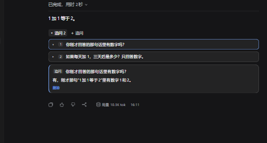

# 追问线 · dsh-followup-thread

在任意一条历史回答下面就地追问，问题和回答一起留在那条回答之后——不把问题丢到对话最底部，也不在左侧工作区里多出一个会话。



## 解决的问题

在会话里回头问一句「你刚才那句是什么意思」，通常只有两种做法，都不太好：

- **把问题发在对话最底部**：上下文被推到当前位置，原来那条回答被挤走，读者要来回翻。
- **用「在新对话中分支」**：左侧会多出一个会话，事后还得手动归档；子会话形式的追问也会出现在会话列表里。

这个插件把追问做成**那条回答的附属内容**：就地展开、就地回答、就地收起。

## 功能

- **＋ 追问**：每条完成回答的下方都有一个入口。
- **Enter 发送**：`Enter` 直接发出，`Shift + Enter` 换行（输入法组合中的 Enter 不会误发）。
- **按问题命名的清单**：同一处有多条追问时，先只显示 `▾ 追问 N`，点开是按问题排的清单，选中哪条展开哪条——不会一屏堆满卡片。
- **折叠状态记忆**：展开/收起与当前选中项按会话记忆，刷新后保持。
- **承接整段对话**：回答依据对话到那条为止的真实经过（包括当时调用了哪些工具、拿到什么结果），而不是只看最后一句的字面意思。
- **不污染会话**：不新建会话、不 fork、不写会话事件，左侧工作区保持干净。
- **失败可恢复**：出错时保留问题，可重试，并附一行诊断（来源、事件数、上下文条数）。

## 安装

需要 DSH `>= 0.2.2-rc.1 < 0.3.0`（桌面端或 `dsh web` 均可）。

```sh
# 从插件市场安装（收录后）
dsh plugin --profile desktop add dsh-followup-thread

# 或直接从 GitHub 安装
dsh plugin --profile desktop add github:1T2TTTTT/dsh-followup-thread
```

也可以在应用的插件管理器里搜索 `dsh-followup-thread`。装好后重启应用（宿主侧代码在启动时组合加载）。

## 工作方式

1. 客户端 `POST ./api/followup-thread/ask`，请求体 `{ sessionId, atSeq, question }`。
2. 宿主侧路由读该会话的事件，把 `atSeq` 之前的对话回放成模型消息（用户文本、助手文本、`[调用 工具] 参数`、`[工具结果 工具] 输出`），预算从靠近那条回答的一端往前花。
3. 用该会话自己的模型路由调用 `ctx.llm.stream(...)`，拼出回答返回。
4. 回答存在浏览器本地，跟着那条回答显示。

详细设计见 [docs/DETAIL.md](docs/DETAIL.md)。

## 边界

- 追问只看到**截止那条回答**的上下文，之后发生的事它不知道，会直说「看不到」而不是编造。
- 追问是只读的：不调用工具、不写文件、不改代码。
- 回答以纯文本显示（保留换行）。
- 数据存在本机浏览器 `localStorage`，不跨设备同步。

## 开发

```
index.js         宿主侧：HTTP 路由 + 会话回放 + 调模型
client.js        客户端：turnTail 槽位、输入框、追问列表
cordis.patch.yml 把插件插入 profile 的 patch
locale/*.json    插件信息（中/英）
docs/DETAIL.md   设计说明与限制
```

- 宿主侧改动要重启应用；客户端改动刷新窗口即可（`Ctrl/Cmd + R`）。
- `node --check index.js && node --check client.js` 可做语法检查。

## License

MIT

---

## English

**dsh-followup-thread** lets you ask a follow-up question under any earlier answer and keeps the question and its answer together, right there — instead of pushing the question to the bottom of the conversation (where the earlier answer scrolls away) or forking into a new session that clutters the sidebar.

- One lightweight `＋ 追问` entry under every completed answer.
- `Enter` sends, `Shift + Enter` breaks the line.
- Multiple follow-ups collapse into a list named by their questions; pick one to read its answer.
- The answer is produced in the Host from the real conversation context up to that answer (including the tool calls and tool results of that session), so it follows the thread instead of the last sentence.
- No new session, no fork, no writes to the session log: the left workspace stays clean.

Install: `dsh plugin --profile desktop add github:1T2TTTTT/dsh-followup-thread`, then restart the app. Requires DSH `>= 0.2.2-rc.1 < 0.3.0`.
